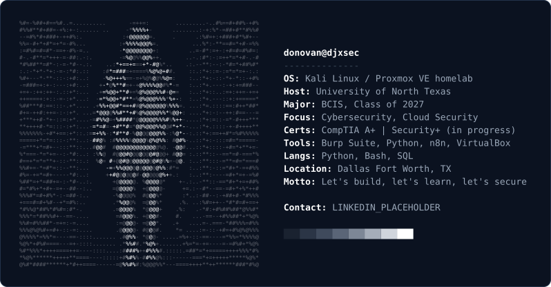

<picture>
  <source media="(prefers-color-scheme: dark)" srcset="assets/card-dark.svg">
  <source media="(prefers-color-scheme: light)" srcset="assets/card-light.svg">
  
</picture>

### About Me

I'm a Business Computer Information Systems senior at the University of North Texas building toward a career in cybersecurity and cloud security. Most of what I learn happens in my homelab: a Proxmox server running Kali, automation workflows, and whatever I'm breaking and fixing that week.

### Featured

| Project | What it is |
|---------|-----------|
| [Linux Installation Notes](https://github.com/DJXSEC/Linux-Installation-Notes) | Documented build of my Kali Linux security lab VM: setup, hardening, networking, troubleshooting |

### Currently

- 📚 Studying for **CompTIA Security+**
- 🧪 Building out my Proxmox homelab
- 🎯 Practicing web app security with Burp Suite
- ☕ Learning Java

### Tools

